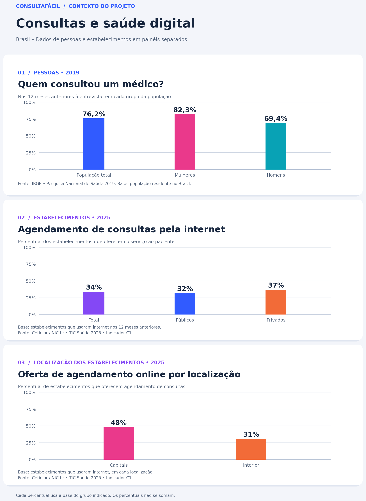

# 3. Problemas ou Oportunidade Identificada

Organizar compromissos relacionados à saúde pode ser difícil quando datas, horários, locais e orientações ficam espalhados entre papéis, mensagens, aplicativos e a memória do usuário. Essa dispersão pode dificultar o acompanhamento, aumentar a possibilidade de esquecimentos ,atrasos e levar a remarcações.

O ConsultaFácil propõe reunir essas informações em uma agenda pessoal. O sistema facilita a consulta dos dados do compromisso e ajuda o usuário a acompanhar o que está próximo ou atrasado. Ele organiza as informações inseridas pelo próprio usuário, mas não confirma se elas estão corretas nem substitui orientações de profissionais de saúde.

### Dados que contextualizam o problema

* **Pessoas - Brasil, 2019:** 76,2% da população, aproximadamente 159,6 milhões de pessoas, consultou um médico nos 12 meses anteriores à entrevista. O índice foi de 82,3% entre mulheres e 69,4% entre homens. Esses dados mostram a frequência de consultas, mas não medem diretamente a dificuldade de organizá-las.&#x20;
* **Estabelecimentos de saúde - Brasil, 2025:** entre os estabelecimentos que usaram internet, 34% ofereciam agendamento de consultas pela internet: 32% de estabelecimentos públicos e 37% privados. O indicador foi de 48% nas capitais e 31% no interior.
* **Faltas a consultas especializadas - Espírito Santo, 2014 a 2016:** Um estudo da Região de Saúde Metropolitana encontrou média de 38,6% de não comparecimento a consultas especializadas. O resultado é regional e não representa uma taxa nacional.

<figure><figcaption></figcaption></figure>

#### Pesquisa exploratória de serviços

Na pesquisa exploratória, foram identificados **cinco exemplos de serviços relacionados a consultas**: Doctoralia, BoaConsulta, Meu SUS Digital, Hapvida Serviços e MedClub. Essa lista não representa todos os serviços existente no Brasil. A disponibilidade dos recursos varia conforme o serviço e sua rede de atendimento.

O ConsultaFácil pretende reunir **profissional, especialidade, data, horário, local e orientações**, além de destacar a próxima consulta e acompanhar seus status. A proposta busca melhorar a organização pessoal. A redução do esquecimento é um benefício esperado que queremos alcaçar mas será melhor avaliada pelos usuários.

#### Principal questão do projeto

> **Como uma agenda digital pode auxiliar o usuário na organização e no acompanhamento de seus compromissos relacionados à saúde?**
